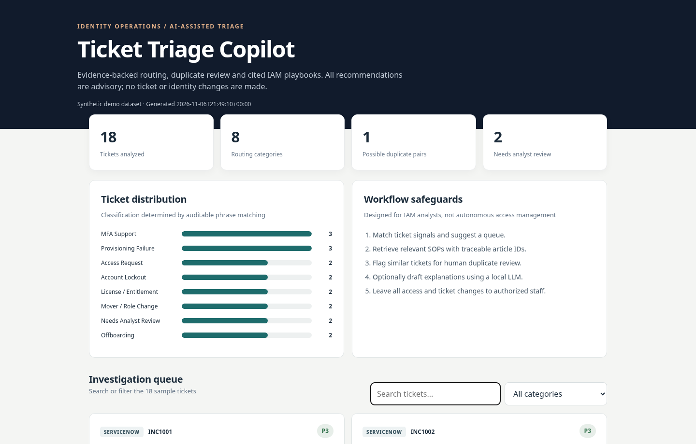
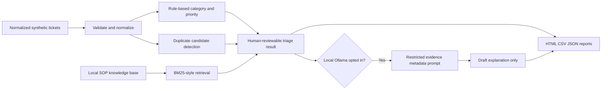

# AI IAM Ticket Triage Copilot

**A practical, read-only IAM operations copilot for ServiceNow/Jira-style tickets.**

[](https://www.python.org/)
[](LICENSE)
[](https://github.com/norones-rgb/ai-iam-ticket-triage-copilot/actions)

> **Portfolio demo, not a ticketing connector.** The included events and KB articles are entirely synthetic. This project does **not** connect to ServiceNow, Jira, Active Directory, Entra ID, SailPoint, NetIQ or production accounts, and never modifies tickets or identities. It is not a substitute for an organization's access approval or incident management policies.

## Explore the demo

**[Open the interactive HTML triage report](https://norones-rgb.github.io/ai-iam-ticket-triage-copilot/)** *(available after enabling GitHub Pages → main → /docs)*



The generated HTML report works offline, including a ticket search and category filter. The optional Streamlit UI supports uploading normalized local JSON/CSV input and downloading updated HTML, CSV, and JSON triage results.

### What it does

| Capability | Implementation | Safeguard |
| --- | --- | --- |
| Ticket ingestion | Validated normalized JSON/CSV; max 1,000 rows | Local files only; no API credentials |
| IAM category suggestion | Auditable phrase-weighted classification, 7 categories + analyst review | Ambiguous/unmatched inputs go to a human |
| Priority suggestion | Explicit P1/P2/P3 heuristics | **Not** an authoritative SLA or incident decision |
| Assignment group | Category-to-queue mapping | Advisory only; never writes back |
| Duplicate detection | Token-set Jaccard overlap with threshold | No merging, closing or deleting |
| Knowledge-base retrieval | Offline lexical BM25-style retrieval with article IDs and snippets | Citations and ranking score shown; no invented SOPs |
| Investigation notes | Approved code-controlled playbook steps | Human review required |
| Optional AI explanations | Ollama local model at numeric loopback `127.0.0.1:11434` | Explicit opt-in; raw ticket text and identifiers excluded from prompt |
| Export | Portable, searchable HTML + CSV + JSON | HTML escaping and CSV formula protection |

### Sample scenarios

- A **NetIQ provisioning failure** across multiple user records, with a possible duplicate ticket
- **Offboarding** verification for a departed employee
- **Account lockout**, **MFA recovery** and **mover/department transfer** investigations
- **Application access requests** awaiting manager and application-owner approvals
- **Jira/Confluence license** reconciliation
- An incomplete ticket that goes to **Needs Analyst Review**
- A **company-wide provisioning outage** flagged P1 *for impact validation*, not automatically escalated
- A mixed grant-and-revoke request explicitly marked **ambiguous**

## Quick start (no API key or paid service)

Requirements: **Python 3.10 or higher**. All core processing uses the Python standard library.

### Windows PowerShell

```powershell
py -3 -m venv .venv
.\.venv\Scripts\Activate.ps1
python -m pip install -e .
iam-ticket-copilot --tickets samples/synthetic_tickets.json --kb samples/kb/iam_playbooks.json --output out
Start-Process out/index.html
```

### macOS / Linux

```bash
python3 -m venv .venv
source .venv/bin/activate
python -m pip install -e .
iam-ticket-copilot --tickets samples/synthetic_tickets.json --kb samples/kb/iam_playbooks.json --output out
```

Open `out/index.html` in your browser. The command also saves `out/triage.csv` and `out/triage.json`.

**No-install alternative:**

```bash
python -m iam_ticket_copilot --tickets samples/synthetic_tickets.csv --kb samples/kb/iam_playbooks.json --output out
```

## Optional Streamlit dashboard

```bash
python -m pip install -e '.[ui]'
streamlit run app.py
```

PowerShell users can use `python -m pip install -e ".[ui]"`.

The app loads synthetic data by default. For demo-only uploads, select local normalized ticket files and optional playbooks, then click **Analyze tickets**. Streamlit is optional; the standalone HTML report requires no installation.

## Optional local AI explanations with Ollama

By default, this application uses transparent rules and offline retrieval, **not** generative AI. If you have Ollama installed and have already downloaded an appropriate model (example: `ollama pull llama3.2:3b`), opt in explicitly:

```bash
iam-ticket-copilot --tickets samples/synthetic_tickets.json --kb samples/kb/iam_playbooks.json --output out --ollama --model llama3.2:3b
```

- Local model calls are restricted to the numeric IPv4/IPv6 loopback address on port `11434`. Redirects and system proxy routing are disabled.
- Model prompts contain **only approved signal phrases, classification, suggested priority, predefined playbook steps and safe KB article IDs**. Ticket subject/description, requester names, and ticket identifiers are not included.
- Model responses remain untrusted drafts and never become evidence or trigger changes.
- If Ollama is unavailable, each result clearly shows a **rules-fallback** status rather than masquerading as an AI-generated answer.
- **Do not use real personnel, ticket, access or credential data without an organization-approved privacy/security assessment**. Locally generated exports preserve ticket subjects and IDs.

## Run tests

```bash
python -m unittest discover -s tests -v
```

CI runs the test suite on Python 3.10, 3.11, 3.12 and 3.13 and compiles the Python modules. Tests include malformed input, category/priority edge cases, duplicate similarity, KB citation validity, local-only AI endpoints, input isolation, HTML escaping and spreadsheet formula injection.

## Architecture



**Design principle:** deterministic code determines what was matched; a generative model can only propose plain-language analysis based on pre-approved metadata. Final triage and any changes remain human decisions.

## Project structure

```text
ai-iam-ticket-triage-copilot/
├── iam_ticket_copilot/
│   ├── classifier.py        # Taxonomy, weighted phrase matching, priority and playbooks
│   ├── duplicates.py        # Candidate duplicate similarity
│   ├── ingest.py            # Input validation and normalized schema
│   ├── models.py            # Typed records
│   ├── narrative.py         # Optional, loopback-restricted Ollama
│   ├── pipeline.py          # No-write orchestration
│   ├── reporting.py         # Offline HTML, CSV and JSON exports
│   └── cli.py               # Command line interface
├── samples/
│   ├── synthetic_tickets.json
│   ├── synthetic_tickets.csv
│   └── kb/iam_playbooks.json
├── tests/                   # unittest test cases
├── docs/                    # GitHub Pages-ready HTML demo and documentation
├── app.py                   # Optional Streamlit app
└── .github/workflows/       # CI pipeline
```

## Documentation

- [Architecture and evaluation](docs/ARCHITECTURE.md)
- [Normalized ticket and KB schemas](docs/DATA_SCHEMA.md)
- [Security threat model](docs/THREAT_MODEL.md)
- [Security policy](SECURITY.md)
- [Contributing](CONTRIBUTING.md)

## Roadmap / potential enterprise extensions

- Human-labeled evaluation set for precision/recall and calibrated triage confidence
- True ServiceNow and Jira **read-only** integrations, behind explicit authentication scopes
- Role-based access controls, retention limits, consent-aware data processing and audit logs
- Stronger semantic retrieval using local embeddings
- Human-approved ticket updates only in a separate, authenticated extension

**License:** MIT. This project is educational software and not endorsed by Microsoft, Okta, OpenText, SailPoint, ServiceNow, Atlassian or any other referenced vendor.
