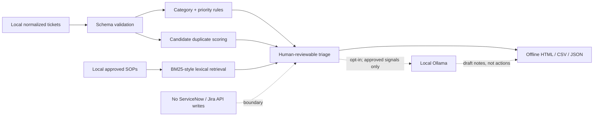

# Two-minute portfolio walkthrough

**Audience:** IAM/IGA engineer, IT automation engineer, or hiring manager. **Data:** 18 made-up ServiceNow/Jira-style tickets, nine fictional SOP articles, and a 12-ticket challenge set. No ticketing API is called.

## Show the working demo

1. Open [the offline interactive triage dashboard](index.html) or the GitHub Pages site if enabled. Search **INC1001**, then **INC1002** to discuss candidate duplicate detection.
2. Filter to **Provisioning Failure**, inspect the cited KB article, and explain that classification and retrieval are **separate deterministic stages**.
3. Open **INC1016** (company-wide provisioning outage). Discuss the **P1 suggestion** and why it still needs incident-manager approval.
4. Open **INC1018**. Mixed grant and revoke signals route to **Needs Analyst Review**, never autonomous fulfillment.
5. Run `python -m evaluation.evaluate`. The familiar synthetic set gives 18/18 categories, but a separate challenge set gives **7/12**. Explain lexical blind spots, not marketing accuracy.

## Architecture and trust boundaries

## What the code proves

- **Explainable routing:** [classifier.py](../iam_ticket_copilot/classifier.py) shows visible phrase weights and review conditions.
- **Local RAG-style search:** [retrieval.py](../iam_ticket_copilot/retrieval.py) returns article IDs, excerpts and transparent ranking.
- **Duplicate discovery:** [duplicates.py](../iam_ticket_copilot/duplicates.py) computes candidates without merging or closing tickets.
- **Privacy boundaries:** [narrative.py](../iam_ticket_copilot/narrative.py) sends only a restricted, explicit opt-in local prompt.
- **Measurable weaknesses:** [evaluation](../evaluation/README.md) records CH001–CH012 challenge errors and the negated-outage false escalation.

**Known gaps:** no real ticketing integration, confidence calibration, semantic embeddings, policy-specific SLAs, deployed RBAC, or tested live LLM evaluation.

## Discussion question for interviews

*What would you fix before connecting this to ServiceNow?* Improve negation/context handling, add an independently reviewed test set, align categories and priority policy with the client, introduce a least-privilege read-only adapter, and require audited analyst approval for any later write action.
